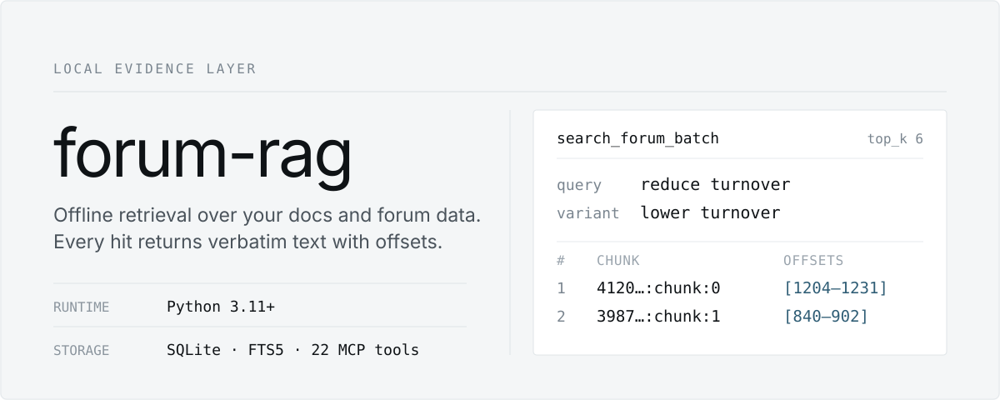

# forum-rag

<p align="center">
  
</p>

<p align="center">
  <strong>A local retrieval and evidence layer for AI agents.</strong><br>
  Official docs, forum posts and knowledge pages live in one SQLite file. Agents check local evidence first and call the online forum less.
</p>

<p align="center">
  <code>Python 3.11+</code> · <code>SQLite / FTS5</code> · <code>MCP SDK 2.x</code> · <code>22 MCP tools</code> · no model by default
</p>

<p align="center">
  <strong>English</strong> · <a href="README_zh.md">简体中文</a> · <a href="README_AGENT.md">For AI agents</a>
</p>

> If Claude Code, Codex, Gemini CLI or another agent will install or operate this project, hand it [`README_AGENT.md`](README_AGENT.md).

## Features

- **Local and light.** Indexing, full-text search, exact lookup and the embedding cache all live in a local SQLite file. No external search service, and no model is loaded by default.
- **Traceable evidence.** Every hit carries a chunk ID, a content hash and source offsets. One call takes several queries in different languages and returns deduplicated posts with evidence.
- **Forum sync (0.3.0).** Sync straight from the Support API with your own BRAIN account, incrementally or in full. Auto sync is off until you turn it on.
- **Separate sources, reusable conclusions.** Docs and forum data use separate tables, FTS kinds and MCP tools. Agents can save conclusions backed by forum posts as knowledge pages, with source bindings, review records, a relation graph and Markdown wiki export.

## Quick start

**1. Install**

```bash
git clone https://github.com/BeastOrange/forum-rag.git
cd forum-rag
uv sync                  # needs Python >= 3.11; run `uv python install 3.11` if you have none
```

<details>
<summary>Using Conda</summary>

The project does not need `uv` at runtime:

```bash
conda create -n forum-rag python=3.11 pip -y
conda activate forum-rag
python -m pip install -e .
```

With Conda, write `uv run forum-rag …` as `forum-rag …` and `uv run forum-rag-mcp` as `forum-rag-mcp`.

</details>

**2. Import docs and search**

Official platform docs are not shipped with the repo. Put your exported `.md` files in any directory (for example `./Documents`, which Git ignores), then import them:

```bash
uv run forum-rag ingest-docs /path/to/your/markdown-docs
uv run forum-rag search-docs "neutralization" --top-k 3
uv run forum-rag show-doc neutralization
```

**3. Add forum data** (optional; see [Forum data](#forum-data) for the three ways)

```bash
uv run forum-rag sync --full                          # full build from the Support API with your BRAIN account
uv run forum-rag refresh /path/to/forum-export.json   # or import a browser-extension export
uv run forum-rag search "alpha decay neutralization" --top-k 5
```

**4. Connect an MCP client.** See [MCP](#mcp).

## Forum data

Forum data comes from a browser-extension export or straight from the Support API. Both land in the same SQLite file. You decide whether to share your account, and how much:

| Mode | How | Does this project see your password? |
| --- | --- | --- |
| **Import an export** | Export JSON with the extension, then run `forum-rag refresh <export>` | No |
| **Manual sync** | Run `forum-rag sync` in your own terminal and type your credentials when asked | Only in memory for that run; nothing is saved |
| **Saved credentials + auto sync** | Run `forum-rag login` once, then choose whether to enable auto sync | Stored in the OS credential store |

```bash
uv run forum-rag login         # verifies online, saves on success, then asks about auto sync (default: no)
uv run forum-rag sync --full   # first full build: all community posts, comments and Help Center articles
uv run forum-rag sync          # incremental sync, starting 2 hours before the last watermark
uv run forum-rag sync-status   # watermark, last result, credential source and backups
uv run forum-rag sync-check    # read-only login and API check; prints no credentials
uv run forum-rag logout        # delete saved credentials and disable auto sync
```

A full build makes about 3 requests per second and takes a while. If it stops, run it again to resume; posts whose comment count is unchanged do not refetch comments. Only a full build that finishes writes the sync watermark, which `sync-status` shows.

<details>
<summary><strong>Credentials: where they are stored and lookup order</strong></summary>

- **Lookup order:** the env vars `WQ_BRAIN_USERNAME` / `WQ_BRAIN_PASSWORD` (both must be non-empty), then the OS credential store, then the plaintext credentials file.
- **OS credential store:** `login` uses `keyring` to write to the macOS Keychain, Windows Credential Manager or Linux Secret Service (GNOME Keyring, KWallet and others).
- **Plaintext fallback:** headless Linux, WSL and Docker usually have no credential store. There `login` first warns clearly that it will store plaintext, then writes `~/.config/wq-forum-rag/credentials` with file mode 0600 in a 0700 directory. Any program running as your user, AI agents included, can read that file; if that bothers you, import exports or sync manually instead. `WQ_FORUM_RAG_CONFIG_DIR` changes the directory. There is no encrypted-file option, because it would need a passphrase on every sync.
- **`login` limits:** it runs only in an interactive terminal and does not accept credentials from pipes or AI tools. It saves nothing if the login check fails. Saving credentials and enabling auto sync are separate choices.
- **Prompting during manual sync:** when `sync` / `sync-check` find no credentials in an interactive terminal, they prompt for them (the password is not echoed) and use them for that run only. Without a terminal, such as inside the MCP server or a shell run by an AI, they do not wait for input. They fail at once with `no_credentials` and tell you to run `forum-rag login` or `forum-rag sync` in your own terminal.
- **Env var risk:** other programs and AI agents in the same session can read env vars. Avoid putting them in your shell profile, and keep them out of the `env` block of an MCP client config: that file is usually plaintext and AI agents read it often.
- **Never persisted:** the password is used only for the BRAIN login call. It is never logged or written to the database. Login cookies live only in process memory.

</details>

<details>
<summary><strong>Auto sync: how it is enabled and when it runs</strong></summary>

For privacy, auto sync is off by default. The setting lives in `~/.config/wq-forum-rag/settings.json` (`{"auto_sync": true}`), next to the plaintext credentials file, and applies to every database and every MCP client. Only `login` (with your answer) and `logout` (writes `false`) change it.

Precedence:

1. A non-empty `WQ_FORUM_RAG_AUTO_SYNC` wins, in both directions: `0` / `false` / `no` / `off` disable it even if settings.json says `true`; any other value (such as `1`) enables it without settings.json. When it is set, `login` / `logout` say that the env var overrides the saved choice.
2. Otherwise, the `auto_sync` value in settings.json applies.
3. With neither, auto sync is off.

When enabled, `forum-rag-mcp` runs one silent incremental sync in a background thread at startup. The server is not blocked, and search keeps working during the sync. All of these must hold:

- auto sync is enabled;
- the database exists and has a sync watermark (from a finished `sync --full`) or an imported forum export;
- credentials can be found;
- the last successful sync is older than the threshold, 3 days by default. Change it with `WQ_FORUM_RAG_SYNC_INTERVAL_DAYS` or the startup flag `--sync-interval-days N`; the flag wins.

Startup never runs a full build and never prompts. It just skips when there is no database, watermark or credentials. Sync logs go to stderr only.

</details>

<details>
<summary><strong>Stale data notice: <code>sync_notice</code></strong></summary>

When forum data is older than the threshold, results from `search_forum`, `search_forum_batch` and `find_by_exact` carry a `sync_notice` field. It holds the last update time, the age in days, the reason, and a suggestion: run `forum-rag sync` in your own terminal, or run `forum-rag login` to save credentials and enable auto sync. Fresh data has no such field.

| Reason | Meaning |
| --- | --- |
| `auto_sync_off` | Auto sync is not enabled |
| `no_credentials` | Auto sync is on, but no credentials were found |
| `login_failed` | The last login failed; the password may have changed |
| `sync_running` | A background sync is running |
| `sync_failed` | The last auto sync did not finish |
| `sync_due` | A sync is due but has not run yet |

</details>

<details>
<summary><strong>Backups and storage</strong></summary>

- **Backups:** before a sync writes to an existing database, it uses the SQLite backup API to create `<db>-before-sync-<UTC time>.sqlite3` under `<db dir>/backups`. One backup is kept by default; change that with `--keep-backups N` or `WQ_FORUM_RAG_KEEP_BACKUPS`. `0` means no backup, and deletes existing ones.
- **Reusing an unfinished backup:** if the last sync did not finish (for example the MCP session ended during a background sync, or a manual run used `--max-pages` / `--community`) and the newest such backup is later than the last successful sync, that backup is reused instead of written again. The result JSON then has `backup_reused: true`.
- **Old backups get cleaned:** retention matches every `<db>-before-*.sqlite3`. So the first sync after upgrading, including the silent startup sync, trims older hand-made `forum-before-*.sqlite3` files down to the kept count. Move any you want out of that directory first, or raise the count. Peak disk use is about the database plus the kept backups.
- **No intermediate files:** API pages are written straight to the database. The only temporary file is the backup's `.partial`, renamed on success and deleted on failure.
- **Help Center articles:** stored as forum topics in communities named `Help Center / <category>`, and searchable with `search` / `show`.
- **Living with exports:** the export auto-refresh before searches skips export files older than the last sync, so a stale export cannot delete or overwrite synced posts. Exports newer than the last sync are still imported, and a manual `refresh <export>` always runs.

</details>

**Known limitations**

- Incremental sync picks posts by `updated_at`, newest first, and fetches comments only for those posts. A new comment on a post whose `updated_at` did not change may wait for the next `sync --full`. In a sample checked during planning, no post's `updated_at` was earlier than its newest comment. But `updated_at` also changes for reasons other than comments, so this does not prove a new comment always bumps it.
- Incremental sync does not remove posts deleted online. Only a `sync --full` that finishes without `--max-pages` / `--community` prunes them. Posts cited by knowledge pages are always kept.

## Bilingual retrieval for agents

The calling AI passes the original question plus keywords in Chinese and English, and gets deduplicated posts with evidence in one call, with no local model:

```text
search_forum_batch(
  query="如何使用 ts_backfill 处理缺失值？",
  query_variants=["缺失值 ts_backfill", "missing values ts_backfill"],
  top_k=6, evidence_chars=600, max_evidence_chars=6000, compact=True
)
```

The CLI follows the same flow:

```bash
uv run forum-rag search-batch "如何使用 ts_backfill 处理缺失值？" \
  --variant "缺失值 ts_backfill" --variant "missing values ts_backfill" --compact
uv run forum-rag forum-evidence "<chunk_id>" \
  --expected-content-hash "<chunk_content_hash>" --max-chars 6000
```

- Results keep the matched queries, a rough language tag, chunk IDs, content hashes and source offsets. Use `get_forum_evidence` for neighboring chunks when context is missing, and `get_post` for the full thread.
- Up to 3 extra queries are accepted. Evidence budgets limit excerpt text only, not the whole JSON or token count.
- `compact=True` (CLI `--compact`) drops the `snippet` that duplicates `evidence[].excerpt` and keeps evidence text, hashes and offsets. The default response stays compatible.
- Batch search and evidence reads share 2 worker slots; when both are taken the tools return `busy`. A client cancel signals the background query, and the slot frees once the thread exits. Cancellation is cooperative, so blocking work such as database lock waits can delay the exit.
- Language tags and scores are not confidence in the facts. Local search does not guarantee relevant posts in both languages; translation and understanding the question are the calling AI's job. Check timeout, lock, degraded-index and truncation states, and do not read a bounded miss as "the forum has no answer".

## MCP

The server reads the index path from `FORUM_RAG_DB`; any tool call can also pass `db`.

```bash
export FORUM_RAG_DB=/absolute/path/.cache/forum.sqlite3
uv run forum-rag-mcp
```

Claude Desktop or any MCP-compatible client:

```json
{
  "mcpServers": {
    "forum-rag": {
      "command": "uv",
      "args": ["--directory", "/absolute/path/forum-rag", "run", "forum-rag-mcp"],
      "env": { "FORUM_RAG_DB": "/absolute/path/.cache/forum.sqlite3" }
    }
  }
}
```

With Conda, GUI clients usually do not run `conda activate` first. Point `command` at the executable in the environment and leave `args` empty: `…/envs/forum-rag/bin/forum-rag-mcp` on macOS/Linux, `…\envs\forum-rag\Scripts\forum-rag-mcp.exe` on Windows.

<details>
<summary><strong>All 22 MCP tools</strong></summary>

| Group | Tools |
| --- | --- |
| Forum search | `search_forum(query, db=None, top_k=5)`<br>`get_post(topic_id, db=None)`<br>`find_by_exact(value, db=None, community=None, top_k=5)`<br>`related_posts(topic_id, db=None, top_k=5)` |
| Batch evidence | `search_forum_batch(query, query_variants=None, db=None, top_k=6, evidence_chars=600, max_evidence_chars=6000, compact=False)`<br>`get_forum_evidence(chunk_id, db=None, before=1, after=1, max_chars=6000, expected_content_hash=None)` |
| Official docs | `search_docs(query, db=None, top_k=5)`<br>`get_doc(slug, db=None)`<br>`ingest_docs(directory, db=None, rebuild=False, prune=True)` |
| Sources | `source_status(source, db=None)`<br>`source_ingest_plan(source, db=None, commit=False)` |
| Knowledge | `build_evolution_context(query, db=None, top_k=5)`<br>`propose_knowledge_page(slug, title, summary, body, source_topic_ids, confidence, db=None, links=None, auto_publish=True, source_evidence=None)`<br>`search_knowledge(query, db=None, top_k=5, include_drafts=False)`<br>`get_knowledge_page(slug, db=None)`<br>`link_knowledge_pages(source_slug, target_slug, relation_type, db=None, weight=1.0, confidence=0.8)`<br>`lint_knowledge(db=None, slug=None)`<br>`publish_knowledge_page(slug, db=None)`<br>`graph_query(slug, db=None, depth=1, relation_type=None)`<br>`export_knowledge_wiki(db=None, output_dir=".cache/wiki", include_drafts=False)` |
| Review and archive | `review_knowledge_page(slug, action, note, db=None, replacement_slug=None)` |
| Maintenance | `rebuild_search_index(db=None)` |

</details>

## Knowledge layer

The project calls no LLM API itself. The MCP client reads, summarizes and judges. This project stores pages, locates evidence, checks source versions, records reviews, links pages in a graph and lints them. Saving knowledge never trains or changes model weights.

1. `build_evolution_context("your question")` returns published knowledge pages first, with full forum evidence.
2. The agent reads the context and draws stable conclusions.
3. `propose_knowledge_page(..., source_evidence=[...])` saves a draft. Each evidence item has a `topic_id`, a `claim` and a verbatim `excerpt`; the system records the source's content hash. Older calls still create drafts; `auto_publish` is kept for compatibility but never skips review.
4. After checking the conclusion, its scope and the excerpts, call `review_knowledge_page(slug, "reviewed", note="...")`, then `publish_knowledge_page(slug)`. An existing source, a located excerpt or a high confidence does not make a conclusion correct; the reviewer judges the support.
5. Later, `search_knowledge(...)` finds saved knowledge. Fall back to forum search when it is not enough.

<details>
<summary><strong>Trust rules, archiving and tables</strong></summary>

- Default search returns only published pages that are reviewed, whose sources are unchanged, that have no conflicts, and whose dependencies are valid.
- Pages in older databases without a reviewed version are excluded until they get evidence and a fresh review. Reads never migrate the database.
- A new `conflicts_with` link makes both pages untrusted. A broken `depends_on` target invalidates the pages that depend on it; `related_to` is not a dependency.
- Archive with `review_knowledge_page(slug, "archived", note="reason", replacement_slug="replacement")`; the replacement is optional. Archiving keeps history and sources, and never overwrites, deletes or rewrites other pages based on publish time or access counts. Existing archived states stay as they are.
- Knowledge lives in the same SQLite file: `knowledge_pages` (pages), `knowledge_sources` (bindings to forum posts), `knowledge_links` (typed edges and backlinks) and `knowledge_events` (append-only history).

```bash
uv run forum-rag evolve-context "alpha decay neutralization" --top-k 3
uv run forum-rag knowledge-search "neutralization" --json
uv run forum-rag knowledge-show alpha/neutralization-decay
uv run forum-rag knowledge-lint
uv run forum-rag knowledge-graph alpha/neutralization-decay --depth 2
uv run forum-rag knowledge-export --out .cache/wiki
```

</details>

## CLI reference

Every command takes `--db` to pick the index; the default is `.cache/forum.sqlite3`. Run `uv run forum-rag --help` for the full list.

| Task | Command |
| --- | --- |
| Check environment and index (read-only) | `doctor` |
| Search / show forum posts | `search "query"` · `show TOPIC_ID` |
| Bilingual batch evidence / expand evidence | `search-batch "query" --variant "…" --compact` · `forum-evidence CHUNK_ID` |
| Search / show / import docs | `search-docs "query"` · `show-doc SLUG` · `ingest-docs <dir>` |
| Credentials | `login` · `logout` |
| Sync the forum | `sync` · `sync --full` · `sync --if-stale --sync-interval-days 3` · `sync-status` · `sync-check` |
| Import an export | `refresh <export>` · `index --json <export> [--rebuild]` |
| Rebuild the FTS5 index | `search-reindex [--chinese]` |
| Source changes | `source-status ./notes` · `source-ingest-plan ./notes --commit` |
| Knowledge layer | `evolve-context` · `knowledge-search` · `knowledge-show` · `knowledge-lint` · `knowledge-graph` · `knowledge-export` |

## Configuration

| Env var | Purpose | Default |
| --- | --- | --- |
| `FORUM_RAG_DB` | Index path used by the MCP server (legacy name `WQ_FORUM_RAG_DB` also works) | `.cache/forum.sqlite3` |
| `WQ_BRAIN_USERNAME` / `WQ_BRAIN_PASSWORD` | BRAIN credentials, highest priority; prefer `login` because env vars leak easily | unset |
| `WQ_FORUM_RAG_AUTO_SYNC` | Overrides the saved auto sync setting | unset, so off |
| `WQ_FORUM_RAG_SYNC_INTERVAL_DAYS` | Staleness threshold for auto sync, in days | `3` |
| `WQ_FORUM_RAG_KEEP_BACKUPS` | Number of pre-sync backups to keep | `1` |
| `WQ_FORUM_RAG_CONFIG_DIR` | Directory for settings.json and the plaintext credentials file | `~/.config/wq-forum-rag` |
| `WQ_FORUM_RAG_AUTO_REFRESH` | Import newer export files before searches; `0` disables | on |
| `WQ_FORUM_RAG_SOURCE` | Export file or directory to scan for auto-refresh (legacy name `WQ_FORUM_RAG_SOURCE_DIR` also works) | last import location, then the database directory and its parent |
| `FORUM_RAG_CHINESE_INDEX` | Set to `1` to enable the Chinese candidate index | off |

## Advanced

<details>
<summary><strong>Docs: incremental import and source isolation</strong></summary>

`ingest-docs` is incremental: documents with the same `content_hash` are skipped, and by default it prunes, removing documents that are no longer in the directory. `--rebuild` clears and rebuilds; `--no-prune` keeps documents that left the directory.

A search for a full title (such as `Operators`) returns the exact title match first and marks it with `exact_title_match`. `score` keeps the raw retrieval score and the other results keep their order; scores are not confidence probabilities.

Docs and forum data are isolated by design:

- Docs use the `documents` / `doc_chunks` tables with FTS kind `doc_chunk`; the forum uses `topics` / `chunks` with FTS kind `forum_chunk`.
- The MCP tool `search_docs` only hits docs, and `search_forum` only hits the forum.
- They share the SQLite file and the embedding cache, but their content never mixes.

</details>

<details>
<summary><strong>Forum exports: indexing and incremental updates</strong></summary>

- Indexing parses light metadata (community, topic, author, time, vote and comment counts) and cleans body text out of HTML.
- `index` skips source JSON whose path, mtime and size are unchanged. Use `--rebuild` after replacing an export or to force a refresh. `refresh` combines forum indexing and the source manifest commit in one step.
- `find_by_exact` matches exact terms in topic IDs, URLs, titles, bodies, comments and chunks. `related_posts` finds related topics in the same community by title.
- Retrieval flow: your Markdown and forum data feed SQLite / FTS5 candidates, which go through lexical ranking and multi-query RRF to the CLI / MCP, and can then become traceable knowledge pages and a Markdown wiki.

```bash
uv run forum-rag index --json /path/to/forum-export.json --rebuild   # first explicit rebuild
uv run forum-rag index --json /path/to/forum-export.json             # incremental afterwards
```

</details>

<details>
<summary><strong>Chinese candidate index (off by default)</strong></summary>

The Chinese bigram candidate index needs no model or extra dependency, but requires SQLite 3.43 or newer. Build it on a copy of the database first:

```bash
uv run forum-rag search-reindex --db /path/to/forum.sqlite3 --chinese
```

Then set `FORUM_RAG_CHINESE_INDEX=1` in the MCP server's environment and reconnect the client to enable it. Unset the variable to return to the original path; the original FTS index is always kept. If the Chinese index is incomplete, the original path is used, and normal queries never build indexes or write to the database.

This path requires every continuous run of Chinese in the query to appear whole in the source field, with multiple runs combined by AND. English and code parts get a literal substring check only: no translation, word boundaries or semantics. The ranking formula is unchanged and candidates are still capped. The index takes extra disk space; check it against your own queries before enabling it. No overall accuracy gain is promised yet.

The optional extra `uv sync --extra local-embeddings` (Conda: `python -m pip install -e ".[local-embeddings]"`) only serves the existing code-level embedding backend. Installing it does not enable separate semantic recall or add MCP tools.

</details>

<details>
<summary><strong>Evaluating retrieval and answers</strong></summary>

Run on a copy of the database:

```bash
PYTHONPATH=src python scripts/evaluate_search.py \
  --db /path/to/forum-copy.sqlite3 --transport mcp --repeats 3 --output /tmp/search-report.json
```

- It records corpus size, a source fingerprint, recall of known targets, false returns for no-answer queries, and first and repeated call latency.
- The default 60 checks were built for this project's local export. They are not a complete human relevance set and cannot support a general accuracy claim. Pass labels that fit your data with `--cases`.
- The first call is not an OS cold cache. Keep reports and logs local; do not commit them.

```bash
uv run python scripts/evaluate_task_evidence.py \
  --runs /path/to/saved-runs.json --judgments /path/to/judgments.json --output /tmp/task-report.json
```

- This script checks saved tasks, actual answers, evidence and independent judgments; the input format is at the top of the script. It calls no AI or search tool.
- Records without a saved answer stay unknown. Refusals and substantive answers with evidence are counted separately.
- Machine judgments are not human accuracy, and `needs_online` is not the number of online calls saved. Use the script to find failures and review evidence, not as a substitute for human acceptance.

</details>

<details>
<summary><strong>Process guard for long tasks</strong></summary>

`scripts/run_bounded_task.py` adds a lease and a time limit to long-running automated tasks such as tests and evaluations. The caller creates the lease file and keeps updating its mtime while it still manages the task; the worker must never renew its own lease.

```bash
touch /tmp/forum-rag-task.lease   # created and renewed by the caller; this example does not renew it
uv run python scripts/run_bounded_task.py \
  --lease-file /tmp/forum-rag-task.lease --lease-ttl 30 --timeout 600 -- python -m pytest -q
```

- After 30 seconds without renewal, or at the total time limit, the task's whole process group is stopped. Stopping renewal or deleting the lease cancels the task, and a normal exit also cleans up leftover child processes.
- If the supervisor is killed, an independent monitor reclaims the task group when the control pipe closes.
- The lease file must exist and be fresh before start.
- The tool uses POSIX process groups, works on macOS and Linux, and cannot cover programs that leave their process group on purpose.

</details>

<details>
<summary><strong>Reading <code>doctor</code> output</strong></summary>

`uv run forum-rag doctor` is read-only: it creates no database, downloads no model and rebuilds no index. It prints JSON with the state of Python, SQLite, the MCP SDK, forum and doc sources and FTS indexes, plus fixes you can run by hand.

- `ready` means local dependencies work and the retrieval structures of at least one configured source are usable. No forum import is needed if you only use docs.
- Each source is listed separately. The command does not prove that an MCP client can connect, or that retrieval is accurate.
- `sync` shows whether auto sync is on and where that setting comes from, the watermark, staleness and the last result.
- `credentials` shows whether credentials were found, their source (`env` / `keyring` / `file`) and whether an OS credential store is available. It never shows the username or password.

</details>

## Upgrading

```bash
git pull
uv sync --locked              # Conda: python -m pip install -e .
uv run forum-rag doctor
```

Then restart or reconnect your MCP client. The server does not hot-reload, and after a restart it should list 22 tools. If tools are missing, check whether the client still points at an old environment or the wrong repo directory. With docs imported, try `search_docs("neutralization")` and `get_doc("operators")`; with forum data, also try `search_forum_batch`.

- **No rebuild needed:** existing forum indexes need no rebuild and no new `refresh`, and should never be deleted. The stdio launch command and its arguments stay compatible. The project uses the official `mcp>=2.3.0,<3` and needs no separate `fastmcp` package.
- **Docs:** run `ingest-docs <dir>` only to add or update docs. If the index holds docs imported from other directories, add `--no-prune` to keep them.
- **0.3.0:** adds forum sync with no new MCP tools. Auto sync is off by default; without it, MCP startup never syncs and nothing else changes. Note that the first sync after upgrading trims old `forum-before-*.sqlite3` files under `backups` down to the kept count (default 1).
- **Help Center articles:** imports before 0.3.0 ignored Help Center articles in exports. Incremental sync only adds articles updated after the watermark; for the rest, run `sync --full` once, or `refresh` a new export with the current version.
- **Semantic search experiment removed:** `search_semantic_forum` and the model preparation and index commands are gone. Use `search_forum_batch` with Chinese and English queries instead. Existing forum SQLite files do not depend on the experiment's model files.

## Data and distribution

| Item | Shipped with the repo | How to get it |
| --- | --- | --- |
| Code, tests, `pyproject.toml` | ✅ | `git clone` |
| Your own Markdown docs | ❌ | Prepare them yourself and import with `ingest-docs <dir>` |
| Forum SQLite (such as `.cache/forum.sqlite3`) | ❌ | Build it locally with your own account: `sync --full`, or export JSON and run `refresh` / `index` |

If you privately share a built SQLite file, the recipient can skip building and just point `FORUM_RAG_DB` at it. Weigh the platform's terms and the risks of sharing data first. The database should not be committed to Git.

## Scope and limitations

- **Done:** full and incremental Support API sync; saved credentials (OS credential store, or a 0600 plaintext fallback); opt-in background sync at startup; stale data notices; export JSON parsing; SQLite post and chunk index; Markdown doc import; FTS5 lexical search; bilingual batch queries with locatable evidence; source manifest; knowledge pages with source bindings; typed graph; wiki export; backlink boost; embedding cache.
- **Known limits:** the Chinese LIKE fallback on older databases can still scan whole tables, so cold or complex queries may time out. The optional Chinese index has not yet shown an overall quality gain, so it stays off by default. Concurrency limits cover MCP batch search and evidence reads only; other tools have no shared rate limit.
- **Not yet:** a full accuracy evaluation with human labels; multimodal import (PDF, screenshots, audio, video); a resident scheduled sync process (startup checks once); LLM-based contradiction detection; external vector databases or seekdb-style service infrastructure.
- **Later:** query-log-driven backfill. Search snippets cannot be stitched into full source text, and knowledge is never retired just because nobody accessed it.

The public CLI / MCP interface is decoupled from the internal `parser`, `storage` and `search` modules. Swapping the embedding backend or tuning chunking and search should not change the existing CLI / MCP interface.
