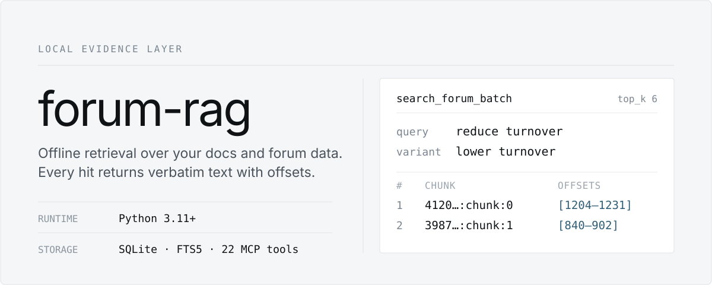

# forum-rag

<p align="center">
  
</p>

<p align="center">
  <strong>给 AI 用的本地检索与证据层。</strong><br>
  官方文档、论坛帖子和知识页都存进一个 SQLite 文件。AI 先查本地证据，少调在线论坛。
</p>

<p align="center">
  <code>Python 3.11+</code> · <code>SQLite / FTS5</code> · <code>MCP SDK 2.x</code> · <code>22 MCP tools</code> · 默认不加载模型
</p>

<p align="center">
  <a href="README.md">English</a> · <strong>简体中文</strong> · <a href="README_AGENT.md">给 AI Agent</a>
</p>

> 让 Claude Code、Codex、Gemini CLI 等 Agent 安装或操作本项目时，直接把 [`README_AGENT.md`](README_AGENT.md) 交给它。

## 特性

- **本地、轻量。** 索引、全文检索、精确查找和 embedding cache 全在本地 SQLite，不依赖外部检索服务，默认不加载模型。
- **证据可追溯。** 每条命中都带片段 ID、内容版本和原文坐标。中英文多个查询一次提交，返回去重后的帖子和证据。
- **论坛自动同步（0.3.0）。** 用自己的 BRAIN 帐号直连 Support API，支持增量和全量同步。自动同步默认关闭，由你决定是否开启。
- **来源隔离，结论可沉淀。** 文档与论坛分表、分 FTS 类型、分 MCP 工具。Agent 可以把有原帖支撑的结论存成知识页，带来源绑定、审核记录、关系图和 Markdown Wiki 导出。

## 快速开始

**1. 安装**

```bash
git clone https://github.com/BeastOrange/forum-rag.git
cd forum-rag
uv sync                  # 需要 Python >= 3.11；没有时先运行 uv python install 3.11
```

<details>
<summary>使用 Conda</summary>

项目运行时不依赖 `uv`：

```bash
conda create -n forum-rag python=3.11 pip -y
conda activate forum-rag
python -m pip install -e .
```

下文的 `uv run forum-rag …` 在 Conda 中写成 `forum-rag …`，`uv run forum-rag-mcp` 写成 `forum-rag-mcp`。

</details>

**2. 导入文档并搜索**

平台官方文档不随仓库分发。先把导出的 `.md` 放到任意目录（例如 `./Documents`，已被 Git 忽略），再导入：

```bash
uv run forum-rag ingest-docs /path/to/your/markdown-docs
uv run forum-rag search-docs "neutralization" --top-k 3
uv run forum-rag show-doc neutralization
```

**3. 加入论坛数据**（可选，三种方式见[论坛数据](#论坛数据)）

```bash
uv run forum-rag sync --full                          # 用 BRAIN 帐号从 Support API 全量构建
uv run forum-rag refresh /path/to/forum-export.json   # 或者导入浏览器插件的导出
uv run forum-rag search "alpha decay neutralization" --top-k 5
```

**4. 接入 MCP 客户端**，见 [MCP](#mcp)。

## 论坛数据

论坛数据可以来自浏览器插件的导出，也可以从 Support API 直接同步，两种来源写入同一个 SQLite。要不要交出帐号、交到什么程度，由你自己选：

| 方式 | 做法 | 本项目是否接触密码 |
| --- | --- | --- |
| **导入导出** | 插件导出 JSON，运行 `forum-rag refresh <导出>` | 不接触 |
| **手动同步** | 在自己的终端运行 `forum-rag sync`，按提示输入帐号密码 | 只在本次运行的内存里使用，不保存 |
| **保存凭据 + 自动同步** | 运行一次 `forum-rag login`，再选择是否开启自动同步 | 保存在系统凭据库 |

```bash
uv run forum-rag login         # 先在线验证，成功后保存凭据，再询问是否开启自动同步（默认否）
uv run forum-rag sync --full   # 首次全量构建：所有社区帖子、评论和 Help Center 文章
uv run forum-rag sync          # 增量同步：从上次水位线往前 2 小时开始
uv run forum-rag sync-status   # 查看水位线、上次结果、凭据来源和备份
uv run forum-rag sync-check    # 只读检查登录和 API，不输出凭据
uv run forum-rag logout        # 删除凭据并关闭自动同步
```

全量构建的请求速率约为每秒 3 次，耗时较长。中途中断后重新运行就能续上，评论数没变的帖子不会重复请求评论。只有完整跑完的全量构建才会写入同步水位线，可以用 `sync-status` 确认。

<details>
<summary><strong>凭据：保存位置和查找顺序</strong></summary>

- **查找顺序：** 先看环境变量 `WQ_BRAIN_USERNAME` / `WQ_BRAIN_PASSWORD`（两个都非空才算），再看系统凭据库，最后看明文凭据文件。
- **系统凭据库：** `login` 通过 `keyring` 写入 macOS 钥匙串、Windows 凭据管理器或 Linux Secret Service（GNOME Keyring、KWallet 等）。
- **明文回退：** 无图形界面的 Linux、WSL、Docker 通常没有凭据库。这时 `login` 先明确警告“将以明文保存”，再写入 `~/.config/wq-forum-rag/credentials`，文件权限 0600，目录权限 0700。以当前用户身份运行的任何程序，包括 AI Agent，都能读这个文件；介意的话请改用导入导出或手动同步。目录可以用 `WQ_FORUM_RAG_CONFIG_DIR` 修改。不提供加密文件方案，因为它要求每次同步都输入口令。
- **`login` 的限制：** 只在交互式终端中运行，不接受管道或 AI 工具传入的凭据。登录验证失败时什么都不保存。保存凭据和开启自动同步是两个独立的选择。
- **手动同步时的输入：** `sync` / `sync-check` 找不到凭据时，在交互式终端里会提示输入，密码不回显，只用于本次运行。在 MCP 服务、AI 代为执行的 shell 等没有终端的环境里，不会等待输入，而是立即以 `no_credentials` 失败，并提示你在自己的终端运行 `forum-rag login` 或 `forum-rag sync`。
- **环境变量的风险：** 同一会话中的其他程序和 AI Agent 都能读到环境变量。不建议写进 shell profile，也不要写进 MCP 客户端配置的 `env` 块：那个文件通常是明文，并且常被 AI 读取。
- **不落盘的内容：** 密码只用来调用 BRAIN 登录接口，不写日志，也不进数据库。登录 cookie 只保存在进程内存里。

</details>

<details>
<summary><strong>自动同步：开启规则和触发条件</strong></summary>

出于隐私考虑，自动同步默认关闭。开关保存在 `~/.config/wq-forum-rag/settings.json`（`{"auto_sync": true}`），和明文凭据文件在同一目录，对所有数据库和所有 MCP 客户端生效。只有 `login`（按你的回答写入）和 `logout`（写入 `false`）会修改它。

生效规则：

1. 环境变量 `WQ_FORUM_RAG_AUTO_SYNC` 非空时优先，开关两个方向都生效：`0` / `false` / `no` / `off` 表示关闭（即使 settings.json 里是 `true`），其他值（例如 `1`）表示开启（不需要 settings.json）。设置了它时，`login` / `logout` 的输出会提示环境变量覆盖了保存的选择。
2. 没设置这个环境变量（或为空）时，使用 settings.json 中的 `auto_sync`。
3. 两者都没有时，自动同步关闭。

开启后，`forum-rag-mcp` 启动时会在后台线程静默运行一次增量同步，不阻塞服务，同步期间检索照常可用。需要同时满足：

- 自动同步已开启；
- 数据库已存在，并且已有同步水位线（完成过 `sync --full`）或导入过论坛导出；
- 能找到凭据；
- 距离上次成功同步超过阈值，默认 3 天。阈值用 `WQ_FORUM_RAG_SYNC_INTERVAL_DAYS` 或启动参数 `--sync-interval-days N` 修改，启动参数优先。

启动时永远不做全量构建，也永远不提示输入。没有数据库、没有水位线或没有凭据时只会跳过。同步日志只写 stderr。

</details>

<details>
<summary><strong>过期提示：<code>sync_notice</code></strong></summary>

论坛数据超过阈值时，`search_forum`、`search_forum_batch` 和 `find_by_exact` 的结果会多一个 `sync_notice` 字段，内容包括上次更新时间、过期天数、原因和建议。建议是：在自己的终端运行 `forum-rag sync` 手动更新，或运行 `forum-rag login` 保存凭据并开启自动同步。数据没过期时没有这个字段。

| 原因 | 含义 |
| --- | --- |
| `auto_sync_off` | 自动同步未开启 |
| `no_credentials` | 已开启，但找不到凭据 |
| `login_failed` | 上次登录失败，密码可能已修改 |
| `sync_running` | 后台同步正在进行 |
| `sync_failed` | 上次自动同步没有完成 |
| `sync_due` | 已到期，尚未同步 |

</details>

<details>
<summary><strong>备份与存储</strong></summary>

- **备份：** 每次同步写入已有数据库之前，先在 `<数据库目录>/backups` 下用 SQLite 备份接口生成 `<库名>-before-sync-<UTC时间>.sqlite3`。默认保留 1 份，可以用 `--keep-backups N` 或 `WQ_FORUM_RAG_KEEP_BACKUPS` 修改；`0` 表示不备份，并删除已有备份。
- **复用未完成的备份：** 如果上次同步没有完整跑完（例如 MCP 会话结束时后台同步被中断，或手动运行了带 `--max-pages` / `--community` 的同步），并且最新的这类备份晚于最近一次成功同步，就直接复用它，不再重写一份。这时结果 JSON 中的 `backup_reused` 为 `true`。
- **会清理旧备份：** 保留规则匹配所有 `<库名>-before-*.sqlite3`，所以升级后的第一次同步，包括 MCP 启动时的静默同步，会把以前手动留下的 `forum-before-*.sqlite3` 删到只剩保留数量。需要的旧备份请先移出该目录，或调大保留数量。磁盘峰值约为数据库本身加上保留份数的备份。
- **不生成中间文件：** API 返回的数据按页处理后直接写库。唯一的临时文件是备份过程中的 `.partial`，成功后改名，失败时删除。
- **Help Center 文章：** 作为论坛主题存储，社区名为 `Help Center / <分类>`，可以用 `search` / `show` 检索。
- **与导出文件并存：** 检索前的导出自动刷新会跳过修改时间早于最近一次同步的导出文件，避免旧导出删掉或覆盖已同步的帖子。比最近一次同步更新的导出仍会自动导入；手动 `refresh <导出>` 不受影响。

</details>

**已知限制**

- 增量同步按帖子的 `updated_at` 倒序挑选帖子，只为这些帖子拉取评论。如果某个帖子有了新评论，但 `updated_at` 没变，这条评论可能要等下一次 `sync --full` 才会入库。规划阶段的抽样检查中，帖子的 `updated_at` 都不早于其最新评论；但 `updated_at` 也会因为评论以外的原因变化，所以这不能证明新评论一定会更新它。
- 增量同步不删除线上已删除的帖子。只有不带 `--max-pages` / `--community`、并且完整跑完的 `sync --full` 才会清理。被知识页引用的帖子始终保留。

## 给 AI 的双语检索

调用方 AI 提供原问题和中英文关键词，一次取回去重后的帖子和证据，不需要本地模型：

```text
search_forum_batch(
  query="如何使用 ts_backfill 处理缺失值？",
  query_variants=["缺失值 ts_backfill", "missing values ts_backfill"],
  top_k=6, evidence_chars=600, max_evidence_chars=6000, compact=True
)
```

CLI 走同样的流程：

```bash
uv run forum-rag search-batch "如何使用 ts_backfill 处理缺失值？" \
  --variant "缺失值 ts_backfill" --variant "missing values ts_backfill" --compact
uv run forum-rag forum-evidence "<chunk_id>" \
  --expected-content-hash "<chunk_content_hash>" --max-chars 6000
```

- 结果保留实际命中的查询、语言粗标记、片段 ID、内容版本和原文坐标。缺上下文时用 `get_forum_evidence` 读取相邻片段，需要完整讨论时再用 `get_post`。
- 最多接受 3 个附加查询。证据字符预算只限制原文片段的长度，不等于整个 JSON 或 token 数量。
- `compact=True`（CLI 为 `--compact`）会省掉与 `evidence[].excerpt` 重复的 `snippet`，证据文本、版本标识和坐标都保留。默认响应保持兼容。
- 批量搜索和证据读取共享 2 个工作名额，满了就返回 `busy`。客户端取消后会通知后台查询，线程退出后才释放名额。取消是协作式的，数据库锁等待等阻塞操作可能会推迟退出。
- 语言标记和排序分数不代表事实可信度。本地搜索不保证两种语言都有相关内容，翻译和问题理解由调用方 AI 完成。调用方要检查超时、锁、索引降级和截断状态，不要把有界检索没命中解读成论坛里没有答案。

## MCP

服务端默认从 `FORUM_RAG_DB` 读取索引路径，每次工具调用也可以单独传入 `db`。

```bash
export FORUM_RAG_DB=/absolute/path/.cache/forum.sqlite3
uv run forum-rag-mcp
```

Claude Desktop 或其他兼容 MCP 的客户端：

```json
{
  "mcpServers": {
    "forum-rag": {
      "command": "uv",
      "args": ["--directory", "/absolute/path/forum-rag", "run", "forum-rag-mcp"],
      "env": { "FORUM_RAG_DB": "/absolute/path/.cache/forum.sqlite3" }
    }
  }
}
```

使用 Conda 时，图形化客户端通常不会先执行 `conda activate`，所以 `command` 要直接指向环境里的可执行文件，`args` 留空：macOS/Linux 是 `…/envs/forum-rag/bin/forum-rag-mcp`，Windows 是 `…\envs\forum-rag\Scripts\forum-rag-mcp.exe`。

<details>
<summary><strong>全部 22 个 MCP 工具</strong></summary>

| 分组 | 工具 |
| --- | --- |
| 论坛检索 | `search_forum(query, db=None, top_k=5)`<br>`get_post(topic_id, db=None)`<br>`find_by_exact(value, db=None, community=None, top_k=5)`<br>`related_posts(topic_id, db=None, top_k=5)` |
| 批量证据 | `search_forum_batch(query, query_variants=None, db=None, top_k=6, evidence_chars=600, max_evidence_chars=6000, compact=False)`<br>`get_forum_evidence(chunk_id, db=None, before=1, after=1, max_chars=6000, expected_content_hash=None)` |
| 官方文档 | `search_docs(query, db=None, top_k=5)`<br>`get_doc(slug, db=None)`<br>`ingest_docs(directory, db=None, rebuild=False, prune=True)` |
| 来源管理 | `source_status(source, db=None)`<br>`source_ingest_plan(source, db=None, commit=False)` |
| 知识层 | `build_evolution_context(query, db=None, top_k=5)`<br>`propose_knowledge_page(slug, title, summary, body, source_topic_ids, confidence, db=None, links=None, auto_publish=True, source_evidence=None)`<br>`search_knowledge(query, db=None, top_k=5, include_drafts=False)`<br>`get_knowledge_page(slug, db=None)`<br>`link_knowledge_pages(source_slug, target_slug, relation_type, db=None, weight=1.0, confidence=0.8)`<br>`lint_knowledge(db=None, slug=None)`<br>`publish_knowledge_page(slug, db=None)`<br>`graph_query(slug, db=None, depth=1, relation_type=None)`<br>`export_knowledge_wiki(db=None, output_dir=".cache/wiki", include_drafts=False)` |
| 审核与归档 | `review_knowledge_page(slug, action, note, db=None, replacement_slug=None)` |
| 维护 | `rebuild_search_index(db=None)` |

</details>

## 知识层

项目本身不调用任何 LLM API。MCP 客户端负责阅读、总结和判断；本项目负责存储、证据定位、来源版本校验、审核记录、图谱连边和 lint。知识沉淀不会训练或修改模型权重。

1. `build_evolution_context("你的问题")`：优先返回已发布的知识页，附带完整的论坛证据。
2. Agent 阅读上下文，归纳出稳定的结论。
3. `propose_knowledge_page(..., source_evidence=[...])`：写入草稿。每条证据包含 `topic_id`、`claim` 和原文中的 `excerpt`，系统会记下来源的内容版本。旧调用方式仍能建草稿；`auto_publish` 参数保留兼容，但不会跳过审核。
4. 核对结论、适用范围和摘录之后，先 `review_knowledge_page(slug, "reviewed", note="审核说明")`，再 `publish_knowledge_page(slug)`。来源存在、摘录存在、confidence 高，都不等于结论正确，支持程度由审核者负责。
5. 之后用 `search_knowledge(...)` 查已沉淀的内容，不够时再回到论坛检索。

<details>
<summary><strong>可信规则、归档和数据表</strong></summary>

- 默认搜索只返回同时满足这些条件的已发布知识：审核通过、来源版本没变、没有冲突、依赖有效。
- 旧库中没有审核版本的知识先被排除，需要补证据并重新审核。读取不会自动迁移数据库。
- 新增 `conflicts_with` 关系后，双方都会失去可信资格。`depends_on` 的失效会传递给依赖它的页面；`related_to` 不算依赖。
- 归档：`review_knowledge_page(slug, "archived", note="废弃原因", replacement_slug="替代页")`，替代页可以省略。归档会保留历史和来源，不会按发布时间或访问次数自动覆盖、删除或改写其他页面。已有的归档状态继续沿用。
- 知识页写在同一个 SQLite 里，相关的表有：`knowledge_pages`（页面）、`knowledge_sources`（与原帖的来源绑定）、`knowledge_links`（typed edges / backlink）、`knowledge_events`（只追加的演化日志）。

```bash
uv run forum-rag evolve-context "alpha decay neutralization" --top-k 3
uv run forum-rag knowledge-search "neutralization" --json
uv run forum-rag knowledge-show alpha/neutralization-decay
uv run forum-rag knowledge-lint
uv run forum-rag knowledge-graph alpha/neutralization-decay --depth 2
uv run forum-rag knowledge-export --out .cache/wiki
```

</details>

## CLI 速查

所有命令都可以用 `--db` 指定索引，默认是 `.cache/forum.sqlite3`。完整列表见 `uv run forum-rag --help`。

| 用途 | 命令 |
| --- | --- |
| 检查环境与索引（只读） | `doctor` |
| 搜索 / 查看论坛 | `search "query"` · `show TOPIC_ID` |
| 双语批量证据 / 扩展证据 | `search-batch "query" --variant "…" --compact` · `forum-evidence CHUNK_ID` |
| 搜索 / 查看 / 导入文档 | `search-docs "query"` · `show-doc SLUG` · `ingest-docs <目录>` |
| 凭据 | `login` · `logout` |
| 同步论坛 | `sync` · `sync --full` · `sync --if-stale --sync-interval-days 3` · `sync-status` · `sync-check` |
| 导入导出 | `refresh <导出>` · `index --json <导出> [--rebuild]` |
| 重建 FTS5 索引 | `search-reindex [--chinese]` |
| 来源差异 | `source-status ./notes` · `source-ingest-plan ./notes --commit` |
| 知识层 | `evolve-context` · `knowledge-search` · `knowledge-show` · `knowledge-lint` · `knowledge-graph` · `knowledge-export` |

## 配置

| 环境变量 | 作用 | 默认 |
| --- | --- | --- |
| `FORUM_RAG_DB` | MCP 服务使用的索引路径（兼容旧名 `WQ_FORUM_RAG_DB`） | `.cache/forum.sqlite3` |
| `WQ_BRAIN_USERNAME` / `WQ_BRAIN_PASSWORD` | BRAIN 凭据，优先级最高；有泄露风险，推荐改用 `login` | 未设置 |
| `WQ_FORUM_RAG_AUTO_SYNC` | 覆盖已保存的自动同步开关 | 未设置，即关闭 |
| `WQ_FORUM_RAG_SYNC_INTERVAL_DAYS` | 自动同步的过期阈值（天） | `3` |
| `WQ_FORUM_RAG_KEEP_BACKUPS` | 同步前备份的保留份数 | `1` |
| `WQ_FORUM_RAG_CONFIG_DIR` | settings.json 和明文凭据文件所在目录 | `~/.config/wq-forum-rag` |
| `WQ_FORUM_RAG_AUTO_REFRESH` | 检索前是否自动导入更新的导出文件，`0` 关闭 | 开启 |
| `WQ_FORUM_RAG_SOURCE` | 自动导入时查找导出的文件或目录（兼容旧名 `WQ_FORUM_RAG_SOURCE_DIR`） | 上次导入的位置，其次是数据库目录及其上级目录 |
| `FORUM_RAG_CHINESE_INDEX` | 设为 `1` 启用中文候选索引 | 关闭 |

## 进阶

<details>
<summary><strong>文档源：增量导入和来源隔离</strong></summary>

`ingest-docs` 是增量操作：内容相同的文档按 `content_hash` 跳过，并且默认会 prune，也就是从数据库删掉目录里已经不存在的文档。`--rebuild` 强制清空重建，`--no-prune` 保留那些已不在目录中的文档。

按完整标题搜索文档时（例如 `Operators`），完整标题命中优先返回，结果中的 `exact_title_match` 会标明这一点。`score` 保留原始检索分数，其余结果沿用原排序；分数不是置信概率。

文档和论坛在设计上完全隔离：

- 文档表是 `documents` / `doc_chunks`，FTS 类型为 `doc_chunk`；论坛表是 `topics` / `chunks`，FTS 类型为 `forum_chunk`。
- MCP 的 `search_docs` 只命中文档，`search_forum` 只命中论坛。
- 两者共享 SQLite 文件和 embedding cache，但内容不会混在一起。

</details>

<details>
<summary><strong>论坛导出：索引与增量更新</strong></summary>

- 索引时会解析 community、topic、作者、时间、投票数、评论数等轻量元数据，并从 HTML 中清洗出正文。
- `index` 根据源 JSON 的路径、mtime 和 size 跳过没有变化的文件；替换了导出或需要强制刷新时加 `--rebuild`。`refresh` 把论坛索引和来源 manifest 提交合成一步。
- `find_by_exact` 精确匹配 topic id、URL、标题、正文、评论和 chunk 中的词；`related_posts` 按标题查找同社区的相关主题。
- 检索流程：自备的 Markdown 和论坛数据进入 SQLite / FTS5 生成候选，经词法排序和多查询 RRF 合并后交给 CLI / MCP，再沉淀为可追溯的知识页和 Markdown Wiki。

```bash
uv run forum-rag index --json /path/to/forum-export.json --rebuild   # 首次显式重建
uv run forum-rag index --json /path/to/forum-export.json             # 之后增量更新
```

</details>

<details>
<summary><strong>中文候选索引（默认关闭）</strong></summary>

中文 bigram 候选索引不需要模型或额外依赖，但要求 SQLite 3.43 或更新的版本。建议先在数据库副本上构建：

```bash
uv run forum-rag search-reindex --db /path/to/forum.sqlite3 --chinese
```

构建后，在 MCP 服务进程的环境里设置 `FORUM_RAG_CHINESE_INDEX=1`，再重新连接客户端，才会启用。取消这个环境变量就恢复原来的路径，原 FTS 索引一直保留。中文索引不完整时继续走原路径，普通查询不会建索引，也不会写库。

这个路径要求查询中的每一段连续中文都完整出现在原字段里，多段之间按 AND 匹配。英文和代码部分只做字面子串检查，不做翻译，不切分词边界，也不理解语义。排序公式不变，候选数量仍有上限。索引会多占磁盘；启用前请用自己的查询核对效果，目前不承诺整体准确率会提高。

可选依赖 `uv sync --extra local-embeddings`（Conda 中运行 `python -m pip install -e ".[local-embeddings]"`）只给现有代码层的 embedding 后端调用。装上后不会启用独立的语义召回，也不会新增 MCP 工具。

</details>

<details>
<summary><strong>评测检索与回答</strong></summary>

在数据库副本上运行：

```bash
PYTHONPATH=src python scripts/evaluate_search.py \
  --db /path/to/forum-copy.sqlite3 --transport mcp --repeats 3 --output /tmp/search-report.json
```

- 记录的指标：语料规模、源码指纹、已知目标的召回、无答案问题的误返回，以及首次和重复调用的耗时。
- 默认的 60 条检查是针对本项目的本地导出构造的，不是完整的人工相关性标注，不能据此声称通用准确率。请用 `--cases` 传入符合你自己数据的标注。
- 首次调用不代表操作系统冷缓存。报告和日志留在本地，不要提交。

```bash
uv run python scripts/evaluate_task_evidence.py \
  --runs /path/to/saved-runs.json --judgments /path/to/judgments.json --output /tmp/task-report.json
```

- 这个脚本核对保存下来的任务、实际回答、证据和独立判断，输入格式见脚本开头。它不会调用 AI 或检索工具。
- 没有保存回答的记录保持“未知”；拒答和有证据的实质回答分开统计。
- 机器判断不是人工准确率，`needs_online` 也不是实际节省的线上调用次数。这个脚本用来定位失败、复核证据，不能代替人工验收。

</details>

<details>
<summary><strong>长任务的进程保护</strong></summary>

`scripts/run_bounded_task.py` 给长时间运行的测试、评测等自动化任务加上租约和时限。调用方先创建租约文件，并在管理任务期间持续更新它的修改时间；工作进程不能自己续租。

```bash
touch /tmp/forum-rag-task.lease   # 由调用方创建并续租；这个示例本身不会续租
uv run python scripts/run_bounded_task.py \
  --lease-file /tmp/forum-rag-task.lease --lease-ttl 30 --timeout 600 -- python -m pytest -q
```

- 超过 30 秒没有续租，或者达到总时限，就停止该任务的整个进程组。停止续租或删除租约可以取消任务，任务正常结束也会清理遗留的子进程。
- 监管进程被强制杀掉时，独立的监控进程会通过控制管道断开，回收任务组。
- 租约文件必须在启动前存在并且没有过期。
- 这个工具基于 POSIX 进程组，适用于 macOS 和 Linux，管不到主动脱离进程组的程序。

</details>

<details>
<summary><strong><code>doctor</code> 输出说明</strong></summary>

`uv run forum-rag doctor` 只读：不建数据库、不下载模型、不重建索引。输出 JSON，列出 Python、SQLite、MCP SDK、论坛与文档来源和 FTS 索引的状态，并附上需要手动执行的修复建议。

- `ready` 表示本地依赖可用，并且至少一种已配置来源的检索结构可用。没导入论坛不影响只用官方文档。
- 各来源的状态分别列出。这个命令不验证 MCP 客户端能否连上，也不验证检索准确度。
- `sync` 显示自动同步是否开启及开关来源、同步水位线、是否过期和上次结果。
- `credentials` 显示能否找到凭据、来源（`env` / `keyring` / `file`）以及系统凭据库是否可用。不显示用户名和密码。

</details>

## 升级

```bash
git pull
uv sync --locked              # Conda：python -m pip install -e .
uv run forum-rag doctor
```

然后重启或重新连接 MCP 客户端。服务进程不会热重载代码，重启后应该能看到 22 个工具；看不到时，检查客户端是否还指向旧环境或错误的仓库目录。已导入官方文档时，可以试 `search_docs("neutralization")` 和 `get_doc("operators")`；有论坛数据时再验证 `search_forum_batch`。

- **不必重建：** 已有论坛索引无需重建，也不需要重新 `refresh`，更不要删除数据库。原来的 stdio 启动命令和参数保持兼容。项目使用官方 `mcp>=2.3.0,<3`，不需要独立的 `fastmcp` 包。
- **文档：** 只有要新增或更新文档时才运行 `ingest-docs <目录>`。如果索引里还有从其他目录导入的文档，加 `--no-prune` 保留它们。
- **0.3.0：** 新增论坛同步，MCP 工具数量不变。自动同步默认关闭，不开启时 MCP 启动不会同步，其他功能不受影响。注意升级后的第一次同步会按保留份数（默认 1）清理 `backups` 下旧的 `forum-before-*.sqlite3`。
- **Help Center 文章：** 0.3.0 之前的导入会忽略导出里的 Help Center 文章。增量同步只补水位线之后更新过的文章，其余文章要运行一次 `sync --full`，或用当前版本重新 `refresh` 一份新导出。
- **语义检索实验已移除：** `search_semantic_forum` 以及模型准备、建索引的命令已不在当前接口中，请改用 `search_forum_batch` 传入中英文查询。已有论坛 SQLite 不依赖实验模型文件。

## 数据与分发

| 内容 | 随仓库提供 | 获取方式 |
| --- | --- | --- |
| 代码、测试、`pyproject.toml` | ✅ | `git clone` |
| 你自己的 Markdown 文档目录 | ❌ | 自行准备，用 `ingest-docs <目录>` 导入 |
| 论坛 SQLite（如 `.cache/forum.sqlite3`） | ❌ | 用自己的帐号在本地建立：`sync --full`，或导出 JSON 后 `refresh` / `index` |

私下共享已建好的 SQLite 时，对方可以跳过建库，只要把 `FORUM_RAG_DB` 指向这个文件。共享前请先评估平台条款和数据分享的风险。数据库默认不应提交到 Git。

## 范围与限制

- **已实现：** Support API 全量和增量同步；凭据保存（系统凭据库，或 0600 明文回退）；默认关闭、需要用户开启的启动时后台同步；过期提示；导出 JSON 解析；SQLite 原帖和 chunk 索引；Markdown 文档导入；FTS5 词法检索；双语批量查询和可定位证据；来源 manifest；知识页与来源绑定；typed graph；Wiki 导出；backlink boost；embedding cache。
- **已知限制：** 旧库的中文 LIKE 回退仍可能全表扫描，冷请求或复杂查询可能超时；可选中文索引还没证明能提高整体质量，所以默认关闭；并发保护目前只覆盖 MCP 批量检索和证据读取，其他工具没有统一限流。
- **暂未实现：** 真人标注的完整准确率评测；PDF、截图、音视频等多模态导入；常驻后台的定时同步进程（目前只在 MCP 启动时检查一次）；由 LLM 自动识别矛盾；外部向量数据库或 seekdb 一类的服务化基础设施。
- **后续方向：** 由查询日志驱动的补采。不能把搜索片段拼成完整原文，也不能因为访问量为零就自动淘汰知识。

对外的 CLI / MCP 接口与内部的 `parser`、`storage`、`search` 模块解耦。之后替换 embedding 后端，或调整 chunk 和检索策略，都不应改变现有的 CLI / MCP 接口。
